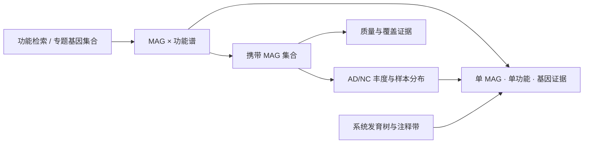

# MAG 可视化完善方案：功能谱、候选研究与基因证据

日期：2026-10-23。状态：设计基线；用户已授权一次性实施，当前实现、数据导入与必要检查见 [实施记录](2026-10-23-mag-functional-implementation.md)。本文保留设计时的阶段安排和核验深度，当前状态以实施记录及代码为准。

本次修订：v1.1。根据用户要求，将**匹配当前 MAG 工作区风格、以 Apache ECharts 实现新增图形**列为明确约束；第 11–15 节补充界面布局、逐图实现、状态和验收细则。原始数据核验结论不变。

## 1. 设计判断

本轮应把 MAG 工作区完善为可以来回查阅的研究链路：**寻找功能 → 找到携带 MAG → 比较这些 MAG 的 AD/NC 样本分布 → 核对质量、覆盖与基因证据**。同时支持从现有候选 MAG 反向查看其功能。

功能注释是本轮核心增量；现有丰度、分类、质量、来源与系统发育入口继续承担各自的研究问题。首轮以功能矩阵和稳定 MAG ID 打通链路，随后增加代谢专题和树旁注释，避免先做一个难以读数的大网络。

新图沿用项目现有 ECharts 6 系列及 React 适配层，标准图采用原生 series，基因区间和树旁轨道采用 `custom`。React 负责控件、表格和抽屉；现有 D3 相机可继续承担手势换算，新增科学图形由 ECharts 渲染，具体约定见第 12 节。

这批汇总足以推进主要功能可视化，不必等待全部 DRAM2 原始目录传完。但“注释结果已收到”“语义核验通过”“导入新发布”“界面已提供”是不同状态，目前不能一起标记完成。特别是 distill 出现了需要先解释的交叉核对差异。

## 2. 本次核对了什么

- 项目背景：`doc/微脑智库_商业计划书_agent阅读版.md` 中的数据库关联和可视化章节，以及 `doc/AD宏基因组生物信息分析流程_agent阅读版.md`。
- 当前实现：MAG 工作区、功能页、详情抽屉、处理流程、来源下载、后端适配器及队列修订仓库。
- 开发经验：10 月 2–8 日的丰度/热图/证据面板/导航/原生 ECharts/聚类树记录，10 月 14 日冷加载修复，10 月 17 日 DiTing 图集，10 月 20 日队列化和 10 月 22 日来源流程更新。
- 方法资料：`G:/project/scripts/13_DRAM/prepare_DRAM_inputs.py`、`run_DRAM_MAGs.sh`，以及已有 DRAMMA、antiSMASH 结果组织方式。脚本仅阅读，未执行上游分析。
- 新汇总：`backend/storage/raw/ad-nc-mag/PRJCA022804/DRAM2/summary/runs/20261022_233830_828587_1595139/`。

完整复核结果见 [本轮核验 JSON](evidence/2026-10-23-dram-summary-audit.json)，可用 [只读复核脚本](../../scripts/audit-dram-summary.py) 重算。文件清单的 SHA-256 是复制完整性证据，不代替科学语义核验。

### 2.1 可直接利用的数据

26 个文件共 254,239,398 字节；归档清单覆盖的 26 个文件、包内 manifest 覆盖的 24 个文件全部通过大小及 SHA-256 核对。872 个代表 MAG：869 Bacteria、3 Archaea。

| 结果 | 特征数 | MAG–特征非零关联数 | 优先用途 |
| --- | ---: | ---: | --- |
| KOfam KO | 6,787 | 839,037 | 核心功能谱、反查携带者、主题基因集合 |
| KOfam EC | 2,466 | 432,644 | 酶功能检索，作为独立命名空间 |
| dbCAN family | 529 | 36,692 | CAZyme 家族热图及分类汇总 |
| dbCAN subfamily | 5,115 | 52,944 | 精细检索及家族下钻 |
| dbCAN substrate | 41 | 9,921 | 底物预测潜力浏览，保留来源复合标签 |
| MEROPS family | 240 | 47,570 | 蛋白酶功能谱默认层级 |
| MEROPS best-hit ID | 35,133 | 102,008 | 高维明细检索，不默认全量铺图 |
| DRAM curated HMM | 9 | 1,784 | 特定功能命中辅助查看 |

8 类计数矩阵与对应存在矩阵逐格一致，且每 MAG 的非零特征数与注释摘要一致。基因表共 2,113,311 行，各 MAG 基因总数与摘要一致；从基因表 `kofam_id` 独立重算，全部 MAG × KO 计数一致。

另与已归档的独立工具结果交叉核对：MAG 集合与 dRep winners、CoverM 长度表及 GTDB-Tk 一致；master/quality-taxonomy 的代表 MAG CheckM2 全字段、GTDB 分类及 CoverM 长度均与原表一致；DRAMMA 预测蛋白总数与 DRAM 基因总数逐 MAG 一致。最后一项只验证数量，不能证明跨工具基因逐条对应。

核验深度并不相同：KO 做了基因级逐格重算；其他七类做了 counts/presence、特征数量及 MAG 集合核对，正式发布前仍应按各自拆分规则从基因级回算，不能把前者的验证结论泛化给所有命名空间。

基因表有 `query_id/input_fasta/scaffold/gene_number/start_position/stop_position/strandedness` 以及命中 ID、部分描述、E-value 和 bit score，可支持基因明细与局部坐标视图。该表不含完整蛋白或核酸序列；不能据此提供不存在的序列下载。

### 2.2 distill 的差异必须先解释

`mag_distill_summary.tsv` 有 6,831 条逻辑记录、4 类 workbook，`gene_id` 只有 6,760 个不同值，不能单独用它作为行主键。按五列元数据组合可区分全部 6,831 行。

在 `gene_id` 恰好为一个标准 KO 且 KO 矩阵包含该 ID 的 1,624 条记录中，1,049 条与 KO 矩阵至少一个 MAG 的值不同，共涉及 187,108 个单元格。以下条目尤其影响肠道研究专题：

| KO（来源描述） | KO 矩阵携带 MAG 数 | 基因注释计数 | distill 全 MAG 求和 |
| --- | ---: | ---: | ---: |
| K00929，butyrate kinase | 229 | 297 | 0 |
| K00634，phosphate butyryltransferase | 47 | 51 | 0 |
| K01580，glutamate decarboxylase | 28 | 29 | 0 |
| K01442，choloylglycine hydrolase | 252 | 270 | 0 |

这些数值由基因注释和矩阵共同支持，**不代表已经确认完整代谢通路，更不代表实际代谢物产生**。目前能确认表间差异，尚不能断言其根因。需核对特定运行的 summary 规则、来源列选择、ID 规范化、兼容补丁及零值含义，不得直接覆盖 raw，或把原始 distill 静默改成 KO 计数。

处理方式：先让 KO/CAZyme 等经核对矩阵进入功能谱；distill 保留原件和差异报告，专题聚合能力独立控制。若需要重算，产生新的汇总运行目录和修订，记录规则及上游运行，保留旧结果。

### 2.3 脚本告诉我们的能力边界

13_DRAM 的运行脚本声明 DRAM2 beta39、固定代码 commit `c9018fc6fc57e5fb6f317370d4fb43e1a98e3d82`，启用 `kofam/dbcan/merops/dram_db` 四类数据库；参数为 `summarize=True`，`traits=False`、`visualize=False`、`save_cgc=False`。因此不能默认承诺 traits、CGC/PUL 或已生成的通路完整度图。

本地 13_DRAM 目录目前只有输入准备及运行两个脚本。汇总记录中的 `summarize_DRAM_results.py` 仅有服务器路径和 SHA-256，脚本本体未在本次本地脚本集合中找到；兼容补丁和对应成功运行快照也需随结果材料核对。这里是方法复现材料的具体缺口，不影响先浏览已核对 KO 矩阵。

DRAM 基因表的 rank 此次只有 D/E（108,501 / 2,004,810 行）。不能把该 rank 直接包装成跨数据库的通用可靠性评分，也不能把其余行统称“无功能”。工具配置、具体命中与覆盖比例应分别呈现。

## 3. 当前页面的实际缺口

| 位置 | 当前行为 | 本轮建议 |
| --- | --- | --- |
| MAG 功能注释 | `MagSourceResults.jsx` 仅提供 ARG/BGC；固定 Top 20 条形图与明细表 | 增加功能总览、功能谱、专题，ARG/BGC 各保留入口 |
| 功能可用性 | 前端只检查 `arg || bgc`，后端 overview 没有 DRAM 功能能力 | 按具体产物与语义验证报告声明能力 |
| 单 MAG 抽屉 | 功能标签只查 ARG/BGC 计数 | 增加 KO/CAZyme/MEROPS 摘要、功能检索、基因下钻 |
| 流程节点 | metabolism 的 tools/modules/scripts 为空 | 绑定 DRAM 注释模块与实际来源，增加结果定位 |
| 来源管理 | raw 文件已归档，storage manifest 尚无 DRAM 解析模块 | 显式声明输入，导入新模块修订，保留旧发布 |
| 系统发育 | 可折叠 ECharts 拓扑树，水平距离不表示分支长度 | 后续增加与叶序严格对齐的功能注释带 |
| 研究拓展模板 | 仍写“功能矩阵、覆盖证据、系统发育待补” | 依据当前发布能力刷新文案，缺分析与缺输入分别描述 |

## 4. 页面组织与交互

保留现有 MAG 一级导航。在“MAG 功能注释”内使用五个紧凑子入口：**功能总览 / 功能谱 / 代谢专题 / ARG / BGC**。基因证据通过同一个详情面板下钻，不新增常驻一级页面。

默认进入功能谱，使用户能立即查对象；总览用于判断目录覆盖与注释情况。专题在规则核验完成后启用。ARG/BGC 继续显示原来源与状态，即使 DRAM 汇总未带 antiSMASH，也继续使用当前发布已绑定的独立 antiSMASH 模块。



所有具体对象保持稳定 MAG ID / feature ID / gene ID；返回原视图时恢复所选对象、排序、分页和视野。点击只定位，明确的“加入比较”才改变比较集合。

### 4.1 功能总览：判断目录是否适合继续研究

顶部紧凑摘要只显示代表 MAG 数、预测基因数、KO/CAZyme 家族等必要规模，数值来自修订报告。主体用两幅互补图：

- 每 MAG 预测基因数 × 已注释基因比例散点；按门分类着色，可切换完整度/污染率色彩。命中图例说明“已注释”的数据库联合口径；单基因多库命中只计一次。
- 功能类型的携带 MAG 数条形图，选择 KO、CAZyme 家族或 MEROPS 家族后显示对应特征，不把不同命名空间的计数相加成一个“功能总量”。

框选只定位目录表。质量参考区间沿用现有定义，不自动称为满足完整 MIMAG 标准；完整度偏低的 MAG 中“未发现”功能不等于生物学不存在。

### 4.2 功能谱：本轮主图

主图为 **MAG × 功能热图**，默认 KO，建议初始展示 40 个 MAG × 30 个功能；全目录可检索，明确展示/匹配/目录三种计数。MAG 行先按属/种层级、再按 ID 排列；默认功能按携带 MAG 数排序，提供按 ID、基因计数及手动顺序切换。

MAG 选择支持分类、完整度/污染率、ID 清单及从既有候选列表加入。功能选择支持命名空间、ID、已有描述、携带 MAG 比例和多选。所有选择先筛后取 Top N，输入草稿点击“应用”才触发重计算。基因表缺 KO 完整描述时先保留 ID；后续由有版本的 KOfam 字典补充，不用不完整 distill 充当全量字典。

热图有两种主要编码：

- **存在/未命中**：默认二值模式，已成功注释且计数为 0 才标“本次未命中”；不可用/未解析单元格为独立灰色。
- **命中基因计数**：顺序色阶，允许 `log1p` 显示，悬浮始终显示原整数。标签称“注释基因计数”，不暗示真实完整基因组拷贝数。

必要时可增加“每千预测基因的命中数”作为明确派生视图，标注分母；它受组装质量及基因组组成影响，不称为质量校正。首版不默认 Z-score，避免把结构性零和相对高值混淆。

行旁注释可选分类、完整度、污染率、当前样本范围 AD/NC 均值及既有 MAG q 值。静态功能谱保持目录范围，均值/q 值明确标为样本范围内的旁注，不让 AD/NC 切换“改写”基因注释。

悬浮显示 MAG、实际解析分类、功能 ID/名称、原计数、来源与注释状态；点击单元格打开“此 MAG 的此功能”基因列表。点击功能标题查看全部携带 MAG，点击 MAG 标签进入统一 MAG 详情。

二值聚类建议 average linkage + Jaccard，计数聚类建议 average linkage + `log1p(count)` 后 Euclidean；作为新增方法定义和验证。全零对象单独置后，避免零集合距离不确定。聚类基于声明的完整比较集合，缩放、分页和换配色不改变结果；功能相似树与系统发育树分别标名。手动顺序和默认分类顺序都不伪装成聚类。

不把 872 × 6,787 一次铺成可读默认图。完整矩阵可下载，大集合采用受控选择/分块读取与视口裁剪；在性能实测前不承诺与现有 872 × 185 热图相同的全量交互上限。

### 4.3 功能反查 MAG：连接现有候选分析

选中一个 KO/家族后，显示携带 MAG 的分类、质量、该功能基因计数，并列出它们在当前样本范围的 AD/NC 均值、Cliff’s δ 和 MAG 层面的原 q 值。支持跳转现有分布图、加入丰度热图和固定比较集合。

该列表回答“哪些 MAG 携带这个功能，这些 MAG 的样本分布如何”，不把每个 MAG 当独立 AD/NC 受试者做检验；从 MAG ID 的 CRR 前缀或组装来源也不能推导一个 MAG 专属于某疾病组。

### 4.4 代谢专题：从研究问题组织，而非堆叠所有工具目录

建议优先评估短链脂肪酸相关、色氨酸相关、GABA 相关、胆汁酸相关、糖类利用及辅因子相关基因集合。这些是待核验的专题定义，不是已经算好的通路或 AD 机制结论。

专题结构为“步骤 × MAG”证据图：标出关键酶/KO、可替代路线、已命中基因及无法评价的步骤，点击步骤回到真实基因。规则需有 `definitionVersion/source/requiredSteps/alternatives/exclusions/evidenceMapping`，经过项目科研口径复核再发布。

首轮可以展示确定的单基因证据，例如 K00929/K00634/K01580/K01442 的携带者，但不能用一个 KO 直接给 MAG 打“丁酸产生菌”“GABA 产生菌”等标签；K01442 的命中也不等于完整次级胆汁酸转化。不要用关键词命中自动生成专题。

distill 核对完成后，可增加其四类 workbook 的层级目录：同化与辅因子、细胞机器、能量获取、环境互作。复合 `gene_id` 可能是逻辑表达式，保留原文和规则，不按分隔符机械展开再相加；同一基因跨条目重复出现，不据此计算“总功能基因数”。有步骤规则后才讨论覆盖比例，不将记录数除法命名为通路完整度。

### 4.5 ARG/BGC：从 Top 20 排名升级为证据浏览

ARG 默认分别显示 HMM 命中、模型候选 passed_0.75、passed_0.95；不把嵌套候选相加，passed 字段不解释为界面自行计算的概率阈值。增加 MAG × 命中名称/原始类别热图，点击进入蛋白记录。按已提供类别组织，不在缺少字典时捏造药物类别或耐药机制。

BGC 增加 MAG × product 类型矩阵和区域长度/contig 坐标图，明细保留边界及区域标记。一个 region 可有多个 product 标签，按 region ID 去重；类型计数之和不等于唯一 region 数。成功零命中、未收到、失败分别显示。

两者采用现有科研工具栏和完整集合导出；从柱形点击定位明细仍保留。后续只有经过基因身份/坐标转换核验才能显示 DRAM 基因与 ARG/BGC 的局部共定位，不能因为预测蛋白总数相同就认定基因逐个相同。

### 4.6 单 MAG 功能详情：形成稳定的研究对象页

沿用 `MagDetailDrawer`。功能标签按 KO、CAZyme、MEROPS、ARG、BGC 显示计数摘要、搜索和明细；功能项点击后进入该 MAG 的基因证据，保留来源模块与修订。

基因证据显示原始 query ID、MAG、contig、起止坐标、方向、命中库/ID、E-value/bit score 的原字段。坐标起点、闭开区间、链方向必须先核对具体工具再统一，保留原值。没有序列附件时只导出注释表。可加入带方向箭头的局部基因布局，但不画成连续完整基因组，也不从距离近推断操纵子或协同功能。

当前基因 ID 含 MAG 前缀，DRAMMA Protein_ID 使用另一种表示。任何跨工具连接必须同时核对 MAG、contig、基因身份/坐标或序列证据；通用关联键不能只用 contig 名或截取最后一个下划线。

成员 MAG 详情只展示代表的功能时明确标注归属，不把代表注释转赋给全部 dRep 成员。

## 5. 全模块的第二层完善

### 5.1 系统发育树 + 功能注释带

现有 IQ-TREE 结果可作为基础。细菌/古菌分别展示，左侧树与右侧分类、质量、选定功能 presence 注释严格共用叶序和缩放；点击叶子打开 MAG 详情。默认少量用户选定功能，不给每个 KO 都分配一条轨道。

当前 ECharts tree 是拓扑布局，独立热图直接拼旁边会错位。需要共享叶布局/坐标投影，过滤或裁剪时记录保留的原树叶子，保留原 Newick。若提供按 branch length 的 phylogram，需要真正按分支长度布局；原拓扑模式仍明确其距离无定量含义。节点支持值保留来源语义。

### 5.2 丰度 + 覆盖联合证据

coverage 模块已有平均覆盖、覆盖比例、reads 数等，不应继续把“尚未接入”的历史模板当成当前事实。单 MAG 样本散点可以切换丰度 × 覆盖广度/平均深度，按 AD/NC 着色；点选回到同一样本。

增加明确的覆盖阈值敏感性浏览，分别报告使用了哪些阈值、保留多少样本/MAG，保持原丰度记录不变。Coverage 门槛的探索筛选不自动构成生物学检出定义。若参与派生功能信号，需要作为计算参数及方法版本的一部分固定。

### 5.3 候选 MAG 的对照面板

由现有丰度候选、功能检索和树叶子都能加入一个稳定比较集合。面板并列分类、质量、功能存在、AD/NC 分布和覆盖依据；多选后以小多图展示，避免不同量纲挤成雷达图或一个综合评分。

不新增未经验证的“益生菌得分”“致病性得分”或临床标签。跨物种页面继续沿用已核验 crosswalk 的可用性，不能因为新增功能结果就通过 GTDB/MetaPhlAn 名称强行互通。

## 6. 群落 KO 的联动及派生样本信号

本地独立核对：MAG 中 6,787 个 KO 与现有群落 9,537 个标准 KO 有 **6,631 个共同 ID**，另有 156 个仅见于 MAG 功能矩阵。这支持按标准 KO ID 建立显式跳转，并不证明数值可相互替代。

群落 KO 详情可增加“在本发布代表 MAG 中查看携带者”；MAG 功能详情增加“查看关联群落 KO 结果”。跳转必须绑定当前 cohort release 的 community revision；没有共同 ID 的条目保留 MAG 证据，不强行生成群落记录。两个画面保留各自单位、方法和覆盖范围；这不是 MAG→MetaPhlAn 物种 crosswalk。

首轮只做这种 ID 及携带者联动。若后续确有研究需求，可另行提供两个名称明确的派生量。设 `a[s,m]` 为 CoverM 百分比，`c[m,f]` 为本次注释基因计数，`p[m,f]=I(c>0)`：

- 携带功能的代表 MAG 丰度和：`B[s,f] = Σ a[s,m] × p[m,f]`，单位为百分点，表示这批携带 MAG 的丰度和。
- MAG 丰度加权注释基因计数：`W[s,f] = Σ a[s,m] × c[m,f]`，单位为“百分点 × 注释基因计数”，属于代理量。

二者都不能称为原始群落 KO 丰度、表达量或代谢通量；不把代表 MAG 丰度再闭合到 100%，不混入群落 DiTing 的原始量纲。存在缺失功能记录时标为不可评价，不当成 0。该推导也未解决不完整 MAG、污染、菌株差异或基因定量偏差。

功能之间携带者重叠，因此跨功能的 B 值不能组成互斥的百分比堆叠。功能/专题聚合按 MAG 或基因去重规则计算，不累计重叠条目制造更高信号。

若计算 AD/NC 差异，以样本为统计单位，完整保留零值；预先声明命名空间、计算 MAG 集合及可检验特征规则，再确定 BH 检验族。Top N、搜索、图形筛选不重算 q 值；有意改变计算集合时生成新分析指纹并显示这一变化。年龄/性别/批次筛选仍不等于协变量校正，不把先按疾病差异挑出的 MAG 子集再检验为独立验证。

## 7. 从此前开发中继承的要求

| 已有经验 | 这次的具体应用 |
| --- | --- |
| 丰度图与表分页独立 | 功能谱选择集合、携带者表页码、基因表页码分别保存 |
| 当前对象稳定 | 搜索、分页、重试和样本范围变化不擅自替换当前 MAG/功能 |
| 显式应用条件 | 选择草稿与已应用条件分开；配色/字号不触发重型查询 |
| 共享视口 | 复用 ZoomableChartViewport、ChartMinimap、ChartPanJoystick、ChartZoomControls |
| 普通滚轮与 Alt 手势 | 普通滚轮滚页面，Alt 缩放/拖动图；拖动后不触发对象点击 |
| 大矩阵渲染与导出 | 复用 MagZoomableHeatmap 的相机、顺序、方法与导出契约；新功能矩阵使用 ECharts 渲染，单独评估分块和规模上限 |
| 原生图表复用 | 汇总条形图复用 ZoomableGroupedBarChart / NativeGroupedBarSurface；分布复用 BoxScatterChart |
| 科研风格统一 | MAG 主题、现有色板/样式/导出偏好；二值、顺序、发散配色分别适用 |
| 折叠保留状态 | 首次展开才初始化图表，隐藏时不在零尺寸容器重建；错误局部恢复 |
| 冷加载问题 | 新功能矩阵和基因表分层按需加载，不进入 overview 全快照 |
| 导出真实集合 | 图像按已应用的完整选择集合重建，排除导航；CSV 不被屏幕视野或表页码截断 |
| 目录与样本范围分开 | 固定功能注释不跟 disease 变化；样本统计旁注和派生图明确接受样本筛选 |
| 真实能力决定文案 | 流程、详情、研究模板、首页和来源说明使用同一模块状态，不保留过期“待完成” |

图像导出包含完整所选集合与方法说明。大型矩阵采用分块/分面或合理的栅格图，不声称一个有限 PNG 能保留全部可读标签；完整数据及有序 ID 单独导出。新图不再次包同类大卡片或重复全局标题。

## 8. 数据接入与代码边界

### 8.1 模块与存储

在 `storage_manifest.json` 显式新增 DRAM annotation 输入及其验证报告，另绑定 distill 汇总和未来专题规则的可用状态；这些是同一上游运行的不同产物，发布时核对共同运行 ID 和 MAG 集合。具体模块键可在实施时确定，但功能谱 ready 不应被 distill 差异一起掩盖。

沿用 cohort → module revision → immutable release；新结果发布时复用未变的丰度、分类、质量、ARG、BGC 模块修订。raw 只读，实际查询从已导入数据库/派生存储读取，不在每次请求扫描 gzip，不恢复已退役的 mag_vN 包加载方式。

八类矩阵共有 1,522,600 个非零 MAG–特征关联，稠密表达共有 43,879,040 个单元格。建议稀疏保存正计数，presence 由计数派生；原 presence 文件仍作为来源和核验对象。为每 MAG/命名空间保存独立分析完成状态，以区分合法隐式零和缺失。

百万级功能关联及 211 万行基因不适合直接沿用“每条 JSON + LIKE 任意搜索”的通用 records 路径。建议专用索引查询层，至少包含：

- 特征字典：`annotation_revision + namespace + feature_id`。
- MAG 功能计数：同修订下的 `mag_id + namespace + feature_id + gene_count`，支持按功能反查 MAG 和按 MAG 查询功能。
- 基因注释：原 query ID、MAG、contig、坐标、各来源字段；对 MAG/contig/gene 建索引。
- 基因–特征关联：支持 namespace/feature → MAG/gene 的分页检索，避免扫描全部基因 JSON。
- distill 行及基因映射：用五列元数据组合的稳定哈希或来源行键，保留原规则表达式和来源位置。

表名及 MySQL/本地测试数据库兼容细节在迁移设计时固定。引入专表仍受 cohort artifact revision 约束；不能复制一套脱离修订的“最新功能数据”。`load_release()` 只带摘要和模块引用，不把所有功能、基因全部装入进程 LRU。

`mag_master_metadata.tsv`、`mag_quality_taxonomy.tsv` 用于交叉验证，不覆盖既有已核验质量/分类/丰度模块；如值冲突，报告具体字段、MAG 和来源修订，不静默择一。

### 8.2 建议查询面

以下为拟议能力，当前不存在对应新接口：

| 查询 | 返回与范围 |
| --- | --- |
| 功能 overview | 按 annotation revision 的规模、数据库、可用性和验证报告 |
| feature search | namespace/ID/字典描述检索，计数与分页 |
| functional matrix | 完整有序 MAG/feature ID、数值、缺失掩码、排序/聚类和投影指纹 |
| feature carriers | 指定功能的完整匹配 MAG；可附样本范围丰度统计，但保留原 MAG 检验族 |
| per-MAG function | 该 MAG 的命中摘要和分页功能列表 |
| gene evidence | 按 MAG/功能/contig 精确筛选、服务端排序分页 |
| theme evidence | 绑定 annotation revision 和 definition revision 的步骤证据 |
| downloads | 完整匹配数据或所选矩阵、参数 JSON、来源记录，规模大时流式导出 |

API 增加明确的 `scopeKind`、`valueKind`、单位、命名空间、annotation revision、规则版本、ordered IDs、来源和验证状态。导出/缓存的键包含这些参数；不同基因库同名 ID 不共用 key。双端 OpenAPI 类型同时更新。

前端把功能视图从 `MagSourceResults.jsx` 拆为独立功能工作区，ARG/BGC 保留可复用组件。不要继续向当前 `MagWorkspacePage.jsx` 的单个条件分支堆积所有新状态；共享视口与表现组件复用，样本丰度、MAG 功能、基因证据各自维护科学适配逻辑。

## 9. 实施顺序与验收

| 阶段 | 可交付结果 | 必须满足的条件 |
| --- | --- | --- |
| P0：数据与口径 | DRAM 新修订接入、功能能力声明、distill 差异记录 | 归档校验；MAG 集合精确匹配；各命名空间基因重算；主元数据冲突检查；不把待核验 distill 当完整通路 |
| P1：主链路 | 功能谱、功能反查 MAG、单 MAG 功能详情、基因分页、全量数据导出；同步流程及来源文案 | 真实数据从功能查到基因并返回；现有丰度分析不变；错误局部恢复；旧修订可复现 |
| P2：专题与已有功能升级 | 核验后的专题步骤图、ARG/BGC 热图及区域图、群落 KO ID 跳转、覆盖证据联查 | 每个专题有版本规则；跨工具 ID/坐标连接通过验证；群落与 MAG 单位分离 |
| P3：综合比较 | 树旁功能/质量注释带、候选对照集合；按研究需求增加派生样本信号 | 叶序/缩放精确同步；派生量名称和统计族明确；大规模加载/导出实测通过 |

distill 根因排查与 P1 的矩阵浏览可以并行推进，不把未知问题掩盖，也不让它阻止所有已可靠结果的利用。

验收以研究动作与数值一致性为准：

1. 搜索 K00929，在无目录筛选的同一修订下得到 229 个携带 MAG、297 条对应基因计数，能分页查看全部携带者与基因；K01580 为 28/29。完整下载与页面总数一致。这些是本次固定汇总的验收值，不写成其他队列的通用常量。
2. 选择 CAZyme 家族可看到所有匹配 MAG，切换计数/存在、排序/转置不改变原值；未命中和未知状态不同，复合底物标签保持原义。
3. 静态功能矩阵不受 disease 改变；样本范围旁注正确变化；新样本范围中不足两组时不显示伪造 p/q。
4. 所选 MAG/功能在表格翻页、独立折叠、错误重试、返回和刷新保存后保持；样式变化不重复查基因或运行聚类。
5. 聚类、树叶和矩阵值通过有序 ID 对齐，恒定/全零、单行/单列、缺失输入、古菌 3 个 MAG 均有真实结果或准确空状态。
6. 默认图、较大集合和高维 MEROPS 搜索实测查询时延、响应体、DOM 数及内存；overview 不读取全部基因；并发相同冷查询不重复构建。指标在实现时测量记录，不把历史机器的时延当本次保证。
7. 桌面、窄屏、键盘、减少动态效果、Alt 手势和完整 SVG/PNG 导出核对，图像含全部所选数据，CSV 不被 Top N 或屏幕视野截断。
8. 新发布与旧发布切换不混用模块，来源下载按修订固定且哈希核验；数据已归档不自动变更当前已发布记录。

## 10. 外部方法参考与适用范围

- [DRAM2 官方介绍](https://github.com/BortonWrightonLabs/DRAM/blob/dev/docs/introduction.md)：区分 ANNOTATE、SUMMARIZE、VISUALIZE，summarized_genomes 是功能基因计数汇总；traits 是单独的产物。本文据此区分命中、主题汇总和更高层解释，不据官方默认能力推定本次运行已全部启用。
- [DRAM 原始方法论文](https://pmc.ncbi.nlm.nih.gov/articles/PMC7498326/)：功能汇总整合多类基因注释并提供代谢解释。当前具体运行及本地表结构优先于通用示例。
- [dbCAN3 原始方法论文](https://pmc.ncbi.nlm.nih.gov/articles/PMC10320055/)：家族、亚家族与底物预测是不同层级；同一家族可对应多类底物。因此 family 与 substrate 分开浏览，不用家族名直接代替已证实底物。

本方案服务于 AD 脑肠轴研究中的候选特征及研究线索。功能命中、合成潜力、组间关联和基因位置证据分别呈现；不扩大为表达活性、临床诊断、已验证生物标志物或因果结论。

## 11. v1.1 风格约束与页面构图

### 11.1 与当前模块逐项对应

本节依据当前组件/CSS，并对照 `docs/previews/mag-heatmap-count-panel-2026-10-08.png` 和 `frontend/src/pages/home/assets/custom-mag-line-2026-10-22.png` 的现有界面。历史截图的 `mag_v3` 标签不作为新界面的数据版本文案；新界面仍显示当前队列发布。

| 部位 | 实际项目基线 | 新功能页的约束 |
| --- | --- | --- |
| 外层结构 | AppShell / MainWorkspace / MAG 左侧导航 | 沿用分析工作区、队列结果选择和现有宽度规则 |
| MAG 主题 | `workspace-theme.css`：accent `#a44060`、soft `rgba(182,87,112,.13)`、标题背景 `#f3eff2` | 读取现有 CSS 变量；选中项、按钮、焦点、导航使用同一主题 |
| 图表区域 | 白色绘图区、浅边线、紧凑标题栏 | 用 `CollapsibleResultSection`，边框/圆角/高度由现有样式定义 |
| 标题栏 | 左侧标题和摘要，中间局部控件，右侧样式及导出 | 所有新图按同一顺序布置；不把 ECharts 默认竖向 toolbox 放到画布里 |
| 字体 | 当前标题栏 13px、摘要 11px、输入/说明约 12px | 复用当前字号层级；图内从已有样式偏好读取，完整 ID 由悬浮和表格提供 |
| 表格 | DataTableViewport、固定 ID、数值右对齐、独立分页 | 功能目录、携带者和基因表均沿用；沿用高度调节、列设置及 CSV 操作位置 |
| 数量选择 | MagTopNSettings / MagHeatmapCountSettings 的弹层 | MAG 与功能数量复用弹层交互，支持常用值、输入、滑条与全部匹配 |
| 样式控件 | ChartStyleToolbar 的紧凑开关、科研色板和更多设置 | 保留一致的配色预览、标签/悬浮/网格/图例、恢复默认和偏好存储 |
| 导出 | 标题栏右侧“导出图像”弹层 | 沿用 SVG/PNG、尺寸、倍率和默认偏好；数据下载放在所属表格标题栏 |
| 详情 | 右侧 MagDetailDrawer，当前宽度 `min(680px,94vw)` | 增加功能内容；不叠加第二层抽屉，基因明细在同一个抽屉内前进/返回 |

主题色用于界面归属，图中数值与类别仍使用当前科研色板。不能为了“配套”把 AD/NC、分类类别和功能计数全部染成同一个玫瑰色。AD/NC 的颜色顺序、纹理及图例沿用现有选定偏好；跨图同步含义，不按每次排序重新配色。

### 11.2 功能谱首屏的空间组织

继续使用现有数据说明及流程区域；进入功能页后，页面从上到下如下。以下是布局规格，数值均从实际修订读取：

```text
MAG 功能注释                         当前发布 · 目录范围 · 方法与来源
功能谱  功能总览  代谢专题  ARG  BGC

功能库 [KO ▼]  功能检索 [...]  MAG/分类检索 [...]  高级筛选
MAG [40个 ▼]  功能 [30项 ▼]  数值 [存在/未命中 ▼]  [应用设置]

⌄ MAG 功能谱   40 MAG × 30 功能       [交换轴] [图形样式…] [导出图像]
  目录/匹配/展示摘要                     [全图  宽度  1:1  缩放]
  可选质量/分类旁注 | ECharts 主热图 | 功能色标
                                      [摇杆 · 全局预览]
  本次未命中 / 命中 / 不可评价 · 数值和排列方法

⌄ 功能目录    全部匹配、当前页          [排序] [列设置] [CSV]
⌄ 携带 MAG    当前所选功能              [加入比较] [CSV]
```

初次进入默认功能谱，功能目录展开；尚未选功能时，携带者区不发送明细请求，可在选中后出现并展开。摘要仅一行，不在每个子视图顶部反复堆叠大型指标卡。功能总览是辅助视图，选择后才加载总览图。

图表/列表独立折叠；已有选择时切换子视图保留上下文。热图点击进入基因详情，不把视图整体替换为另一张图。只有明确“查看分布”才进入既有单 MAG 分布页，返回时恢复功能谱位置。

### 11.3 控件分层和自适应

- 页面上方只放影响数据选择/分析的条件：命名空间、检索、MAG/功能集合、计数口径、聚类及样本统计范围。可见计数编码的快捷切换只保留一处；在标题栏提供时不再在上方重复。
- 标题栏局部控件放“排名”“显示数量”或“区域排序”等本图选择；纯样式工具放右侧。左右两部分在窄屏按当前 flex-wrap 规则换行，不给整页制造横向滚动。
- 缩放、适应宽度、1:1、摇杆和预览继续使用现有位置；为右下角导航预留绘图区空间。小型总览散点只保留局部缩放/框选，参考现有质量图，无需再增加摇杆。
- 高级筛选折叠，集合草稿未应用时标“有未应用更改”；画面更新保留上次成功结果。失败提示仅作用于失败区域，保留可操作工具栏。
- 桌面 1440/1920、工作区 1024/760 和窄屏 390px 均需实际检视。窄屏堆叠摘要和控件；表格保留组件内横向滚动，图例换行，右侧抽屉沿用现有响应规则。

## 12. ECharts 图形规格与选择理由

当前 `frontend/package.json` 声明 `echarts ^6.1.0`。所有新增图通过现有 EChartBase/core 适配层及按需注册；不新增第二套图表库或重新导入整包 `echarts-for-react`。下表中的新图及新适配组件均是拟议实现。

| 研究视图 | 默认图 | ECharts 实现 | 第一层交互 |
| --- | --- | --- | --- |
| 功能谱 | MAG × 功能矩阵 | `heatmap` + `visualMap` + category axes；旁注为独立 series/grid | 格子 → MAG+功能基因；列头 → 携带者；行头 → MAG 详情 |
| 功能总览 | 注释比例散点、特征携带数条形图，作为两个可独立折叠的结果区域 | `scatter`；复用原生 `bar` 适配器 | 框选/点选定位 MAG，条形定位功能 |
| 功能携带者 | 当前功能的 MAG 基因计数横条 | `bar`；支持显示样本 AD/NC 丰度对比的独立面板 | 选 MAG → 详情/既有分布 |
| CAZyme / MEROPS | 家族/底物携带数与矩阵 | 同一功能谱适配器切换 namespace | family → subfamily/底物证据；保留来源多重标签 |
| 代谢专题 | 步骤 × MAG 矩阵 | 离散 `heatmap`；单 MAG 步骤路线为固定布局 `custom` | 步骤 → 可替代 KO 及实际命中基因 |
| ARG | 命中/候选排名；MAG × 原始命中类别矩阵 | `bar` / `heatmap` | 类别或格子 → 对应蛋白记录 |
| BGC | product 携带矩阵；contig 区域轨道 | `heatmap` / `custom` 区间 | 区域 → product、边界及原始记录 |
| 基因证据 | 当前 contig 的局部基因箭头 | `custom`；value x-axis 表示 bp | 箭头 → 原始 ID、坐标、库及命中字段 |
| 覆盖联查 | 丰度 × 覆盖广度/深度散点 | `scatter` + 必要 `markLine` | 点选样本，与当前 MAG 样本表联动 |
| 系统发育整合 | 树 + 质量/功能轨道 | 共享叶坐标的多个 `custom` series/grid | 叶子/轨道 → 同一个 MAG 详情 |

柱形/折线切换只在含义适用的已有丰度图中沿用。功能类别、MAG 排名没有连续顺序含义，新增功能排名图默认不开放折线；专题路线也不使用力导向布局，使相同研究对象每次打开保持位置。

### 12.1 核心热图：数据、编码和视口

数据项至少保留 `id/magId/namespace/featureId/rawCount/status/value`；ID 由稳定键组合，点击事件使用实体键，不能依赖当前排序的 dataIndex。转置时只交换轴位置，数据项的 MAG/功能语义不交换。

存在模式使用 `visualMap.type='piecewise'` 对 0/1 显式编码；计数模式用连续色阶，`value=log1p(rawCount)` 仅用于颜色时，色标明确写出变换，tooltip 和 CSV 仍为原计数。各 visualMap 明确绑定 `seriesIndex/dimension`，不让主计数色阶覆盖旁边的质量/分类轨道。

不可评价项不转换为 -1 参与计数范围：独立的状态掩码/系列绘制，提供“不可评价”文字图例；未知与合法零的背景/标记有可识别区别。全零选集保留矩阵和准确提示，不自动换成有命中的功能。

默认不显示逐格数字，空间足够且用户打开“数值”后才显示；完整标签进入 tooltip 与数据表。标签稀疏显示不能改变实体选择集合。轴标签触发与系列触发分开注册，响应相应 MAG/feature 事件。

共享相机是世界范围与可见范围的唯一来源。使用 `dataZoom` 适配世界窗口；原生滑动条若启用，事件也回写同一个相机。相机同步的 action 使用静默及重入保护，避免 D3、ECharts inside 和摇杆同时处理一个滚轮。普通滚轮滚页面，Alt 才缩放，框选时锁定平移。

不能仅因为用了 `dataZoom` 就认为数据已分块。普通大小把完整已选矩阵交给 ECharts；更大选择按明确的性能预算获取和绘制窗口块，使用全局有序 ID、固定全集色域及 backend 聚类顺序。窗口变化不改变 Top N、聚类、色阶、数量或检验族。预览底图可由后端聚合或一次性缩略投影生成，不能把它当精确测量热图。

默认 40 × 30；可选 MAG 20/40/80/200、功能 10/30/60/100 以及自定义。首轮建议 SVG 标准热图支持到 20,000 个展示单元格作为待实测预算，例如 200 × 100；超预算仍允许完整检索和数据下载，并明确引导缩小集合或分块模式。该预算不是已完成的性能保证，最终上限由真实数据、浏览器和导出结果决定。

### 12.2 功能总览与携带者：让图与表各有职责

总览散点固定定义 x=预测基因数，y=联合注释基因比例，默认点大小一致、分类着色；大小如切换为基因组长度，图例必须给出单位。避免把质量、大小、透明度同时映射为多个未标明的指标。轴从真实数据和必要边距确定，百分比轴保持合法范围。

排名条形图的计数轴从 0 起，整数刻度；显示“携带 MAG 数”与“注释基因计数”时分别切换轴名及说明，名次数值不称为差异显著性。默认 Top 20，支持现有数量弹层与全部匹配。旁边的目录列表仍可按其他列排序，不改变图形对象。

携带者默认在图下方表格展示；需要条形图时独立展开“携带者比较”。当前功能基因计数与 AD/NC 平均丰度用两个共享 MAG 顺序的面板，分别有单位和数轴，不使用双 y 轴将基因数与百分比叠成单一曲线。既有 MAG p/q 是旁注，不为静态基因计数伪造组间检验。

### 12.3 基因/BGC 区间：用 custom 表达真实坐标

`custom.renderItem` 将 bp 起止映射为区间或方向箭头；每个 contig 独立一行，x 轴表示原 contig 坐标。MAG 不同、contig 名相同的记录保持不同实体。来自不同 contig 的横坐标只用于各自定位，不暗示它们在一条组装染色体上的先后关系。

区间 zoom 声明起点和终点都参与 x 编码；采用保留跨窗口区间的过滤策略（如经验证的 `weakFilter`），并按绘图区边界裁剪。一个基因从可见窗口外延伸进入图内时仍需保留，不只按起点过滤。箭头方向来自真实链向，最小可点击宽度只扩大命中区域，不扩大实际 bp 长度。

BGC 显示 region 区间与产品标签，悬浮标明来源边界类型；区域重叠分层排列。多 product 通过标签和 tooltip 表达，不给同一个 region 画成多个独立基因簇。没有可靠的跨工具对应时，BGC 与 DRAM 基因分开显示，不能画伪共定位。

只有完整 contig 的基因列表已经取得时才能称为“该区间所有基因”；只查询某 KO 命中时，标为“该区间匹配基因”，不由匹配记录数猜测邻域完整性。数据请求按 contig+坐标区间，不用表格当前页拼出局部基因图。

### 12.4 系统发育复合图：共享坐标，不拼接两个自动布局

原有折叠拓扑树继续可用；“树与功能”作为新增模式。对所有展示叶生成固定整数 leafIndex，内部节点位置来自子树叶布局；每个树/注释 grid 共用数值 y 轴范围 `[-0.5,n-0.5]`、方向、plot top/height 及同一 dataZoom 窗口。

树分支用 `custom` 绘制，功能轨道也用 `custom` 矩形，避免一侧 category 带宽与另一侧 value 轴产生半格错位。树 x 坐标在拓扑模式表示层级；在真实 phylogram 模式才使用累计 branch length。固定叶序、内部节点信息及有序 ID 由版本化投影提供，不让 ECharts 自动 tree 排布后再猜测叶坐标。

折叠分支表示集合时，旁注默认显示“折叠，含 N 个叶”，不能伪装成一个 MAG 的功能。若提供集合汇总，需单独标“携带叶数/可评价叶数”，绝不与单叶 presence 共用含义。首轮可只做展开叶与筛选子集，后续再支持折叠集合轨道。

### 12.5 专题图、补充图及暂不默认提供的图型

专题首图仍为步骤证据矩阵，能直接对照 MAG。单 MAG 路线图按审核过的步骤与替代关系固定布局，由 `custom` 节点/连线表达；节点文字使用步骤名，命中/未命中/不可评价使用固定离散图例。线宽不表达未提供的代谢通量。

若后续需要多个功能携带集合的交集，采用 UpSet 风格的 `bar + custom` 点阵，交集数必须按同一 MAG 集合精确计算；只作为明确请求后的补充。分类汇总若提供气泡矩阵，气泡编码须写明是数量还是比例，并使用正确分母，不能让大分类的绝对数量看起来像富集。

Sankey、力导向网络、雷达、仪表盘不列入首轮默认图集。功能多重归属会使 Sankey 连线不守恒；近邻网络和雷达也需要另外定义科学距离或归一化。图型扩展应由研究问题推动，不能只因为 ECharts 提供该图型就加入。

## 13. ECharts 与现有组件的接入设计

### 13.1 复用与新增边界

| 现有组件 | 复用方式 | 必要适配 |
| --- | --- | --- |
| EChartBase / CartesianEChart / HeatmapEChart | 保留 renderer、ARIA、图像导出和按需注册入口 | custom、heatmap、visualMap、dataZoom 等在对应入口注册，不依赖其他页面碰巧先注册 |
| ChartFrame / CollapsibleResultSection | 一层页面框架、独立图/表区域、标题栏 actions | 通过已有 context portal 注入样式与导出，不在图内重复创建工具条 |
| ChartStyleToolbar / useChartStylePreferences | 现有开关、科研色板、更多设置、保存和恢复 | 按图 kind 定义可用字段；功能谱不显示“柱宽”，基因图不显示无意义的丰度选项 |
| ZoomableGroupedBarChart / NativeGroupedBarSurface | 功能/携带者排名与已有丰度比较 | 明确计数单位及功能 ID，关闭无连续语义的折线切换 |
| MagResearchChart | 总览/覆盖等小型散点的风格及局部交互 | 当前 decorateResearchOption 假设单 x/y 轴，不直接套到多 grid 复合图 |
| ResearchChartSurface | 参考共享相机、预览、导出和事件约定 | 其当前实现对 grid/visualMap/轴数组有单图假设，复合树/轨道需专用适配器 |
| MagZoomableHeatmap / magHeatmapOption | 借鉴顺序、缩放、图例、方法和全量导出契约 | 原图是样本 × MAG，新图是 MAG × 功能，不能交换名称后复用其样本过滤或 Z-score 逻辑 |
| MagDetailDrawer / DataTableViewport | 同一研究对象详情及基因表 | 完整函数键和坐标查询；基因表独立分页，功能错误不清空分类/丰度 |

建议新增局部组件为 `MagFunctionalWorkspace`、`MagFunctionalHeatmap`、`MagFunctionalOverview`、`MagFunctionCarrierPanel`、`MagGeneEvidence`；ARG/BGC 从既有组件拆分，树旁注释另建专用 surface。option 构建分别放入纯函数，返回图形配置和实体映射，便于数值与点击对齐核查。

这些是拟议文件名。实施时先检查现有共用接口，只提取实际被两处使用的逻辑，避免为一张图制造庞大的通用图表框架。

### 13.2 状态划分与事件

应用状态分为数据选择、展示样式、导航窗口、具体实体、分析结果五部分。建议 URL 保存可分享的子视图、namespace、功能/MAG 标识、已应用集合与必要样本范围；大型 ID 清单使用有上限的持久化策略。样式按图 kind 存储，集合按 release/annotation revision 隔离。

| 操作 | 状态变化 | 不应发生的连带变化 |
| --- | --- | --- |
| 点击热图单元格 | selected MAG+feature，加载该组合基因，打开原抽屉 | 不替换手动比较集合、不切换子视图 |
| 点击功能标题/目录行 | selected feature，更新携带者区域 | 不自动换掉热图已选 MAG 或整个功能集合 |
| 点击 MAG 标签/条形 | selected MAG，详情保持当前上下文 | 不改变结果列表页码和另一张图的排名 |
| 框选 | 更新临时选择，提供加入集合动作 | 不自动删减计算集合或重算 FDR |
| 修改配色/字号 | 本地 option 和预览变化 | 不请求原始基因、不运行聚类、不重置缩放 |
| 翻页 | 当前表格的页码变化 | 不改变图形和其他表页码 |
| 应用选择/排序 | 新 projection，校验后更新图形和摘要 | 不将 pending 草稿与旧图标为同一结果 |
| 切换发布 | 重新解析能力及 ID，清理不兼容实体 | 不静默带入旧修订的特征/基因证据 |

事件里传递稳定实体键，使用 `dispatchAction` 做瞬时 highlight/downplay；单选不每次重建整个 series。需要同步多个图时显式协调实体及坐标，不仅使用 `echarts.connect` 就假定不同命名空间/坐标含义一致。

### 13.3 更新、渲染与导出

同一图型使用稳定 series/data ID 合并更新；删除系列时定向 replaceMerge，切换坐标体系时清理旧轴和 visualMap。避免每次样式更改都 `notMerge` 重建，丢失图例、窗口与选择。密集热图和基因大集合关闭不必要动画；小条形图沿用现有入场/更新节奏，并遵守减少动态效果设置。

新功能谱、专题和复合注释图首轮采用 ECharts SVG，便于与现有导出链一致并避开此前记录的特定异步 Canvas 销毁问题。既有原生丰度柱图仍可沿用其 Canvas 适配，不把历史问题扩大成“Canvas 都不可用”。大矩阵若验证后采用 ECharts Canvas，须连同切页、卸载、折叠及 PNG 导出做实际压力检查；不得仅切换 renderer 就宣称性能问题解决。

导出使用完整已应用集合和同一 option 构建器，在独立实例中布局；移除 tooltip、brush、dataZoom、HTML 导航和临时高亮，保留主题、图例选择、原始有序实体和方法。SVG 按可读范围分面；PNG 沿用现有 16,384 单边/3,200 万总像素约束和明确的尺寸反馈。

“图像导出”导出当前明确选择集合；“当前图形矩阵”对应同一集合；“完整匹配数据”可覆盖 Top N 之外对象。这三个范围在操作名中区分，导出的参数 JSON 保存 projection ID、图形 kind、变换、顺序、聚类及图像参数。无法在预算内导出的超大图给出可执行的分面/缩小范围选项，不生成被截断却标为完整的文件。

## 14. 首轮具体页面与真实研究路径

建议 P1 完成四张可独立使用的 ECharts 图：功能谱热图、功能携带数条形图、MAG 注释比例散点、单 MAG 局部基因轨道。外加功能目录、携带者表和基因明细，以这条真实路径验收：

1. 从已有候选列表固定一个 MAG，打开抽屉“功能潜力”，可搜索此 MAG 的 KO/CAZyme/MEROPS，点击功能查看基因。
2. 进入功能谱搜索 K00929，在无额外目录筛选时能看到完整 229 个携带 MAG 的计数；默认图只显示用户指定数量，表和完整下载包含全部匹配。
3. 点击列标题打开携带者表，按已有 MAG q 值排序；手动加入几个 MAG 比较，跳到既有 AD/NC 分布，零丰度样本保留。
4. 返回原功能谱，所选功能、MAG 集合、缩放和表页码恢复。点击某个有命中的格子，抽屉展示对应基因、contig 与实际坐标；在局部轨道点选同一条记录。
5. 切换到 dbCAN family，界面结构与工具栏位置不变，只改变特征命名空间、单位说明和适用控件。切换样式不重新请求明细。

P2 将 ARG/BGC 页面纳入同一风格并提供经核验的专题；P3 实施树与功能复合图。群落 KO ID 跳转和覆盖联查可在相应数据接口完成时穿插，不必等待所有专题完成。distill 差异只影响依赖其规则的能力，不阻塞可靠 KO 功能谱。

## 15. v1.1 增补验收与参考

除第 9 节数值验收外，新增以下界面/ECharts 验收项：

- 与现有丰度/热图同一窗口并排核对主题、标题栏高度、字号、边框、按钮、弹层、表格及抽屉；控件顺序和行为一致。
- 热图转置、列表排序、窗口裁剪后，以实体 ID 核对点击结果；过滤全零、未知单元格和 3 个古菌仍可正确浏览。
- 各 visualMap 不串色；显示模式切换后旧色标和旧 series 清理；恢复视图与恢复样式是不同动作，名称明确。
- 树叶与轨道单元格中心误差按 CSS 像素实测，目标不超过 1px；resize、dataZoom 和分支操作后重复核对。
- 基因区间跨窗口边界、反向基因、同名 contig、重叠 BGC 和仅匹配基因的范围说明均正确。
- 热图/散点/条形/轨道的图形、只读表与导出数值一致；连续切页、折叠再展开及离开工作区无遗留实例、侦听器或异步绘制异常。
- 超过显示/导出预算时给出明确范围和替代操作，不偷偷截断；空态和查询失败仍保留筛选、样式和重试入口。

ECharts 实现参考仅作为 API 与设计依据，具体项目行为仍须在当前安装版本验证：

- [官方 custom series 指南](https://echarts.apache.org/handbook/en/how-to/custom-series/)：标准图以外通过 `renderItem` 构建区间、箭头及复合轨道，仍使用 ECharts 图表生命周期。
- [官方 custom series 配置文档源码](https://github.com/apache/echarts-doc/blob/master/en/option/series/custom.md)：核对 encode、坐标和渲染接口。
- [官方 SVG / Canvas 选择说明](https://echarts.apache.org/handbook/en/best-practices/canvas-vs-svg/)：renderer 需结合元素规模与设备验证；本项目额外考虑既有销毁和导出回归记录。

v1.1 的交付重点是统一布局与 ECharts 技术路线，并把数据选择、图形表达、对象下钻和证据范围落实到每个操作。它仍是待实施方案，不表示新页面已上线。
